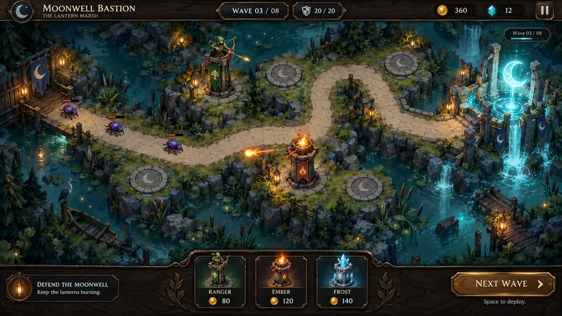
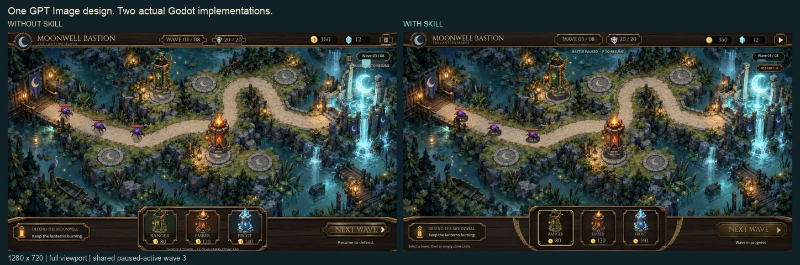

# Godot UI Fidelity

[English](README.md) · [简体中文](README.zh-CN.md)

**Build game-native Godot UI. Verify the actual result.**

An agent skill for UI design, approved-reference implementation, native interaction, texture budgets, and rendered acceptance.

## From GPT Image design to a playable Godot battlefield

A complete tower-defense battle screen: marsh islands, moving enemies, attacking towers, resource HUD and live build cards. The workflow starts with **one common GPT Image design**, then two independent agents implement it using the same assets, simulation, model selection and Godot toolchain. Only one reads this skill.

**1. Shared design target — generated concept art**



**2. Actual Godot gameplay — left without skill, right with skill**



Both panes show the full 1280×720 viewport in the same real paused-active wave. Resume runs the battle; towers, enemies, resources, build and upgrade controls use live state. The design reference is never used as a baked runtime interface.

The design preview is **97 KB** and the gameplay comparison **156 KB**: about **253 KB total** on this page. The anonymous review judged the pair close overall: the skill version has clearer action icons and better bottom-hint spacing; the baseline's deck surround is slightly closer to the reference. Both passed eight groups of real browser input checks. First-pass sources and observed defects are retained in the [results](demos/battle-comparison/RESULTS.md).

**[Run both versions, see the compact comparison, and inspect sources/evidence →](demos/battle-comparison/README.md)**

The earlier [text-only settings trial](demos/settings-comparison/README.md) remains archived. This is one implementation pair, not a general quality guarantee.

## What it helps with

- Turn a UI brief or approved reference into a measured Godot implementation.
- Keep dynamic labels, rewards, focus, pause, and modal behavior connected to real state.
- Preserve artwork proportions while checking adjacent touch targets together.
- Plan source and imported texture sizes, atlas regions, and nine-slice coordinates.
- Report visual, interaction, and technical evidence separately.

## Install in Codex

For a user-wide editable checkout:

```sh
mkdir -p "$HOME/.agents/skills"
git clone https://github.com/shunying-games/godot-ui-fidelity.git "$HOME/.agents/skills/godot-ui-fidelity"
```

For a versioned project dependency, run from your project repository:

```sh
git submodule add https://github.com/shunying-games/godot-ui-fidelity.git .agents/skills/godot-ui-fidelity
git add .gitmodules .agents/skills/godot-ui-fidelity
git commit -m "Add Godot UI Fidelity skill"
```

On another machine, initialize the dependency with `git submodule update --init --recursive`. Choose one discovery location per project to avoid duplicate skill names. Codex also follows symlinked skill folders. See [official skill documentation](https://learn.chatgpt.com/docs/build-skills). Changes are usually detected automatically; restart Codex if the skill does not appear.

Other agents can use the same `SKILL.md` package through their supported skill loader; automatic discovery varies by host. The runtime and publication helpers require Python 3.10 or newer and only use its standard library. The optional image-derivation and screenshot-composition helpers use Pillow. No API key, cloud account, or design service is required by this package. Image creation and rendering capabilities depend on your environment.

## Use

```text
Use $godot-ui-fidelity to implement this approved settings design.
Preserve current gameplay and verify the result in the actual renderer.
```

```text
Use $godot-ui-fidelity to investigate overlapping touch targets in this HUD.
```

The entry point routes to references for [design](references/design-and-assets.md), [implementation](references/godot-implementation.md), [texture budgets](references/texture-budgets.md), [acceptance](references/acceptance.md), and [skill evaluation](references/skill-evaluation.md).

## Keep project rules separate

Put project-specific references, engine/export commands, asset paths, save isolation, and confirmed gameplay constraints in your project's `AGENTS.md` or documents it links to. The skill reads applicable project policy before work. Keep personal paths, credentials, and raw QA output outside this public checkout.

Example project instruction:

```markdown
For Godot UI work, use godot-ui-fidelity and read docs/agent-guides/godot-ui.md
for this project's reference assets, rendering setup, and gameplay boundaries.
```

This separation lets reusable improvements go upstream without publishing project data. A project's private notes stay with that project; they are not dependencies of this package.

## Contribute and update

Work directly in the installed Git checkout so changes have one source. For a submodule, create or switch to a development branch inside it before editing; fresh submodule checkouts can be detached. Enable the repository's local hooks once per checkout:

```sh
python3 scripts/install_hooks.py
python3 -B -m unittest discover -s scripts -p 'test_*.py'
git add SKILL.md references scripts
python3 scripts/check_publication.py --staged
git diff --cached
git commit -m "Improve Godot UI guidance"
git push origin HEAD:main
```

Use your fork and a pull request when you do not have write access. Stage only intended files. Before publishing, configure Git with your GitHub noreply email; both author and committer metadata are checked. The local hooks check the staged snapshot and outgoing commit history. CI repeats tests and history checks after upload; CI alone cannot prevent an initial disclosure.

After updating a submodule, commit its new revision in the parent project. For updates from upstream, use `git pull --ff-only` on the skill's branch. Publication is a deliberate Git action, not a background file watcher.

## Privacy checks and limits

`scripts/check_publication.py` checks tracked file paths/content, commit messages, and author/committer email for recognized sensitive patterns. Diagnostics report locations and categories without printing matching values. Tests include staged content and secrets hidden in older outgoing commits. Reviewed documentation figures are approved by exact path and SHA-256, limited to 220 KB each, and checked for unwanted WebP metadata. Original battle source/runtime art and the licensed font have separate exact hash/size approvals; PNG ancillary metadata is excluded. Pixel content still requires human review.

The checks do not prove that every secret or private fact is absent. Review names, business information, examples, and the staged diff yourself. Local hooks can be bypassed and are not installed automatically by Git. Do not put real credentials in examples or tracked test fixtures. If a real credential was already published, revoke it and arrange history cleanup; deleting it from the latest file does not remove earlier copies.

## License and sources

[MIT](LICENSE). See [ACKNOWLEDGMENTS.md](ACKNOWLEDGMENTS.md) for workflow influences and technical sources. Original demo sources/art and reviewed small documentation figures are included. Cinzel retains its bundled SIL Open Font License. No third-party skill packages, Godot binaries, or private game assets are bundled.
