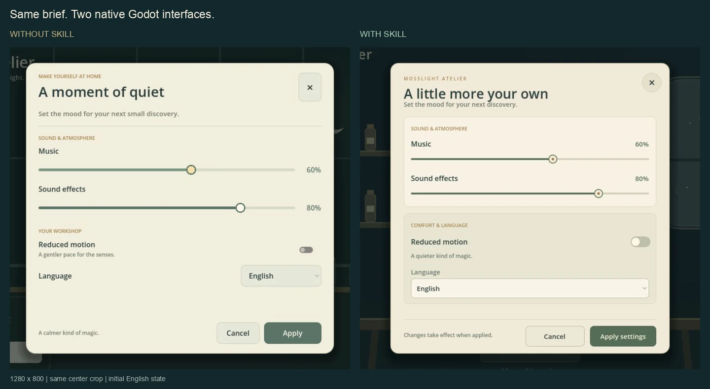
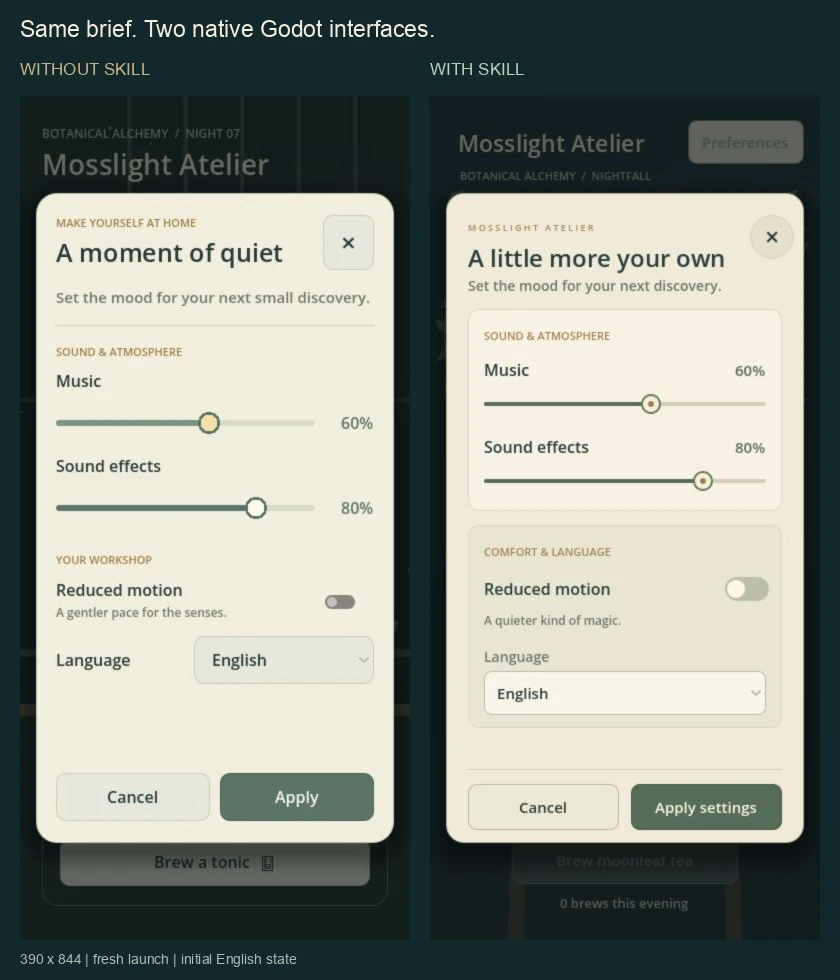

# Godot UI Fidelity

[English](README.md) · [简体中文](README.zh-CN.md)

**做出属于游戏的 Godot UI，用实际运行结果验收。**

面向 AI 编程助手的技能，覆盖界面设计、参考图还原、原生交互、贴图预算与真实渲染验收。

## 先看真实 Godot 对照 Demo

两个独立代理使用同一份冻结需求、相同模型选择和 Godot 工具链。**左侧未使用本技能，右侧使用本技能。** 图片来自真实 Web 运行画面。



桌面 UI 局部对照：两张 1280×800 截图采用相同裁切范围。**43 KB。**



390×844 手机首次启动，使用默认英文文案。**49 KB。** 两张图片合计不到 100 KB。

本次 skill 版本的工坊场景和卡片分组更丰富。两版均通过八项核心浏览器操作检查，匿名视觉评审均为 **8/10**。长文案压力测试也发现了 skill 版本中一处动作说明重叠，基线版在该项处理得更稳；首次提交源码和这一限制都如实保留。

**[运行交互 Demo、查看源码与完整测试方法 →](demos/settings-comparison/README.md)**

这是一次对照示例，不能据此保证所有任务的质量提升。本仓库提供技能指引与工具，实际实现和渲染使用你项目的引擎及已授权能力。

## 能做什么

- 将界面需求或参考图转成有测量依据的 Godot 实现。
- 让动态文字、奖励、焦点、暂停和弹窗读取真实状态。
- 保持美术比例，同时检查相邻触控区域是否重叠。
- 规划源图与运行贴图尺寸，处理图集和九宫格坐标。
- 分别报告视觉、交互与技术检查的结果和边界。

## 在 Codex 中安装

安装为用户级、可直接编辑的 Git 工作副本：

```sh
mkdir -p "$HOME/.agents/skills"
git clone https://github.com/shunying-games/godot-ui-fidelity.git "$HOME/.agents/skills/godot-ui-fidelity"
```

作为项目内固定版本的依赖，在项目仓库中执行：

```sh
git submodule add https://github.com/shunying-games/godot-ui-fidelity.git .agents/skills/godot-ui-fidelity
git add .gitmodules .agents/skills/godot-ui-fidelity
git commit -m "Add Godot UI Fidelity skill"
```

在新机器上执行 `git submodule update --init --recursive` 初始化依赖。同一项目选择一种发现位置，避免同名技能重复出现。Codex 也支持指向技能目录的符号链接，详见 [官方技能文档](https://learn.chatgpt.com/docs/build-skills)。修改通常会自动发现；未显示时重启 Codex。

其他 AI 助手可按各自的技能加载方式使用本仓库的 `SKILL.md`，自动发现规则由宿主决定。运行与发布检查工具需要 Python 3.10 及以上版本，仅使用标准库；可选的截图拼图工具使用 Pillow。本技能本身不需要 API Key、云账号或设计服务；图片生成和真实渲染能力取决于当前环境。

## 使用示例

```text
使用 $godot-ui-fidelity 实现这张已选定的设置页设计图。
保持现有玩法，在实际渲染器中验证界面效果。
```

```text
使用 $godot-ui-fidelity 排查这个 HUD 相邻触控区域重叠的问题。
```

入口会按任务读取 [设计](references/design-and-assets.md)、[实现](references/godot-implementation.md)、[贴图预算](references/texture-budgets.md)、[验收](references/acceptance.md) 或 [技能评估](references/skill-evaluation.md) 文档。

## 项目规则如何独立维护

把项目专属的参考图、引擎与导出命令、素材路径、存档隔离方式和已确认玩法边界，放进项目自己的 `AGENTS.md` 或其链接的文档。技能开始工作前读取适用的项目规则。个人路径、凭据和原始验收产物放在这个公开工作副本之外。

项目指引示例：

```markdown
进行 Godot UI 工作时使用 godot-ui-fidelity，并阅读
docs/agent-guides/godot-ui.md 中的项目参考资源、渲染流程和玩法边界。
```

通用经验可以提交到技能仓库；项目资料留在项目中，不成为公共技能的依赖。

## 修改、提交和更新

直接修改安装后的 Git 工作副本，保持一份源文件。使用子模块时，先在子模块内创建或切换开发分支；新初始化的子模块可能处于 detached HEAD。每个工作副本先安装一次本地检查钩子：

```sh
python3 scripts/install_hooks.py
python3 -B -m unittest discover -s scripts -p 'test_*.py'
git add SKILL.md references scripts
python3 scripts/check_publication.py --staged
git diff --cached
git commit -m "Improve Godot UI guidance"
git push origin HEAD:main
```

没有仓库写权限时，通过自己的 fork 和 Pull Request 提交。仅暂存本次要发布的文件。发布前把 Git 作者邮箱配置为自己的 GitHub 隐藏邮箱；检查会覆盖作者和提交者元数据。本地钩子检查暂存快照和待推送提交历史，CI 会在上传后重跑测试与历史检查；仅靠 CI 无法阻止首次泄露。

子模块更新后，还要在父项目提交其版本指针。更新上游时，在技能开发分支执行 `git pull --ff-only`。提交和推送由明确的 Git 操作完成，不会因保存文件自动发布。

## 隐私检查与边界

`scripts/check_publication.py` 检查已跟踪的文件路径、正文、提交说明及作者和提交者邮箱中的已知敏感模式。报告只显示位置和类别，不回显匹配到的敏感值。测试覆盖暂存内容，以及藏在旧待推送提交中的敏感信息。两张文档图片按精确路径和 SHA-256 批准，每张限制为 220 KB，并检查 WebP 中的额外元数据；像素内容仍需人工复核。

自动检查不能证明所有秘密或隐私事实都已排除。发布前仍需人工复核姓名、业务信息、示例和暂存差异。本地钩子可以被绕过，Git 克隆也不会自动启用它们。示例和已跟踪测试数据中不要使用真实凭据。如果真实凭据已被发布，应先撤销凭据，再处理历史；只删除最新文件无法清除旧副本。

## 许可与来源

采用 [MIT 许可证](LICENSE)。工作流启发与技术资料见 [ACKNOWLEDGMENTS.md](ACKNOWLEDGMENTS.md)。本仓库不附带第三方技能包、Godot 引擎或私人游戏素材，包含小型原创 Demo 源码及两张经过复核的截图。
