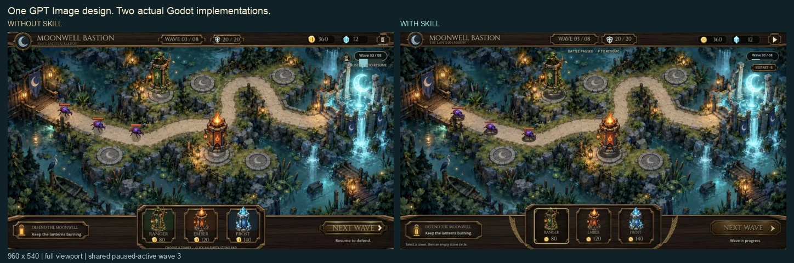

# Moonwell Bastion: GPT Image design → native Godot gameplay

[English overview](../../README.md) · [中文介绍](../../README.zh-CN.md)

This is a full battle-screen implementation comparison. One built-in GPT Image design was created first; two independent implementers then received that same reference, generated map/actor/chrome assets, font, brief and authoritative simulation. One read the frozen Godot UI Fidelity skill; the other used general Godot knowledge and was asked to make its best polished implementation.

## The shared design target


This is generated concept art. It is not a runtime screenshot. Its metadata-free source pixels, clean-map edit, actor atlas and empty chrome atlas are included under [source-art](source-art/GENERATION.md), with [prompts](source-art/PROMPTS.md), [crop/resize/source hashes](source-art/ASSETS.json) and the font's [OFL license](shared/assets/OFL-Cinzel.txt). The built-in image tool did not expose a pinned image-model identifier.

## Actual Godot results




Both are actual Godot Web renders. Each pane shows its entire viewport, uniformly resampled; labels sit outside the captured pixels. The primary captures use the same initial paused-active wave 3, seed 1729, tick 0: gold 360, crystal 12, lives 20, two towers and three enemies. This is the real default game state, not a capture-only replacement. Resume starts movement, spawning, targeting, projectiles and resource changes.

The reference's pause glyph and enabled Next Wave are interpreted in favor of actual state: the initial UI must offer Resume, and Next Wave remains unavailable while wave 3 is active. Enemy positions/health follow the common model. The clean map is a generative edit with small composition differences, not a layered extraction; both candidates use the same edit and coordinates.

## Observed result

The anonymous pixel review scored the skill version 52.5/63 and the baseline 50.0/63 across visual categories only. Their 2.5-point gap is a **practical tie** under the predeclared 3-point threshold. The skill version has clearer resume/restart presentation and better bottom-hint spacing; the baseline's deck surround proportions are slightly closer to the design. The baseline's unresolved action glyphs and clipped bottom hint remain in the frozen first pass.

Both versions passed **8/8 actual browser check groups** covering paused selection/resize, pause invariance, blocked paused purchases/HUD routing, native resume/build, upgrade/occupied selection, combat progression/keyboard pause, Next Wave/repeated start, and restart. These are observations, not a claim that all predeclared browser checks passed. Full details, unverified flows and evidence limits are in [RESULTS.md](RESULTS.md) and [PROTOCOL.json](PROTOCOL.json).

The overview loads only the 97 KB reference preview and 156 KB gameplay comparison, about 253 KB combined. This detailed page also shows the 172 KB compact figure. Full-resolution generated source art is stored separately and is not loaded by the overview.

## Run both playable versions

Install official Godot 4.6.3.stable with its matching non-threaded Web templates. From the skill repository root:

```sh
python3 scripts/build_comparison.py \
  --demo battle-comparison \
  --godot /path/to/Godot \
  --templates /path/to/4.6.3.stable \
  --output "$(mktemp -d)" \
  --probe --serve
```

Open the local URL printed by the command, then choose a candidate. Open a candidate's `index.html` directly for exact 1280×720 or 960×540 viewport checks. The common builder exports both from isolated project/engine copies and serves only on loopback; generated output stays outside Git. Only macOS was validated for this release.

- Resume using the top-right control or `P`.
- Select Ranger, Ember or Frost, then click an empty stone pad to build if affordable.
- Click an existing tower, then use Upgrade to improve it.
- Pause to inspect the battlefield; selection remains available but purchases/start are disabled.
- After the current wave clears, Next Wave or `Space` starts the next one.
- `R` or Restart restores the initial paused-active battle. This small demo has waves 3 through 8 and a real win/loss state.

For editor exploration, copy `shared/` to a new working directory and overlay either `without-skill/` or `with-skill/` into it. The common scene loads the chosen `main.gd`. Keep caches outside this source package.

## Reproduce the common checks and assets

```sh
python3 scripts/run_battle_model_tests.py --godot /path/to/Godot
```

The model runner uses a fresh temporary project and exits nonzero unless its 90 assertions pass. These assertions test simulation/economy/pause invariants, not either candidate's pixels or native input. `harness/test_probe.gd` separately checks passive JSON evidence collection using a synthetic root. The optional `--probe` publishes read-only state and actual native control geometry in an inert DOM node; it never sends commands or substitutes a renderer.

The generated source images are retained with exact pixel content, stripped of ancillary metadata. With Pillow installed, reproduce the published runtime images into an empty directory:

```sh
python3 scripts/prepare_battle_assets.py \
  --source demos/battle-comparison/source-art \
  --output "$(mktemp -d)"
```

Crop dimensions, alpha bounds, resampling, source/runtime sizes and SHA-256 values are recorded. No private game art or normal saves are needed. Cinzel is the same official Google Fonts binary for both conditions and retains its separate SIL Open Font License.

## Audit and limitations

- [Shared task brief](BRIEF.md), [model API](shared/API.md), [predeclared evaluation](EVALUATION.md)
- [Frozen source hashes](SOURCE-SHA256.json), [run protocol](PROTOCOL.json) and [results](RESULTS.md) accompany the final candidates.
- The same coordinator model selection was inherited by both independent agents, with no model override and no previous conversation history. The exact backend model identifier and random seed for generation were not pinned.
- The skill version was frozen before implementation. Common asset creation and the simulation were supplied equally, so the comparison concerns implementation with the skill, not exclusive access to better art.
- First-complete candidate source is preserved. Shared harness fixes are documented separately; an anonymous review precedes source/self-assessment inspection.
- One scene and one implementation per condition cannot establish a general causal quality advantage, statistical significance, real-device performance or production readiness.

The [earlier settings trial](../settings-comparison/README.md) remains archived with its original sources, screenshots and known limitations. It did not use an image-design-first workflow and is not the headline gameplay example.

Raw screenshots, logs, reports and Web exports stay outside Git. Only the reviewed compressed documentation figures are displayed here.
