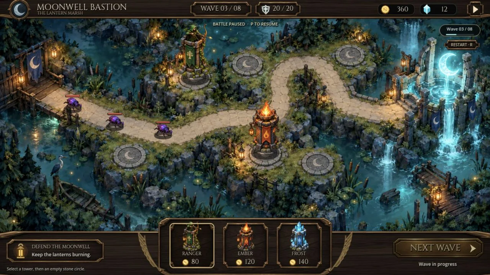

# Moonwell Bastion: GPT Image design → native Godot gameplay

[English overview](../../README.md) · [中文介绍](../../README.zh-CN.md)

A standalone tower-defense battle screen built with Godot UI Fidelity. The workflow begins with a GPT Image design, derives a clean map and sprite assets, and implements native Godot controls connected to an authoritative battle model.

## 1. GPT Image design


The design is generated concept art. Its metadata-free source pixels, clean-map edit, actor atlas and empty HUD atlas are included under [source-art](source-art/GENERATION.md), with [prompts](source-art/PROMPTS.md), [measured crops and hashes](source-art/ASSETS.json) and the font's [OFL license](shared/assets/OFL-Cinzel.txt). The built-in image tool did not expose a pinned image-model identifier.

## 2. Skill-assisted Godot implementation



This actual Godot Web capture shows the full 1280×720 viewport in the initial paused wave 3: seed 1729, tick 0, gold 360, crystal 12, lives 20, two towers and three enemies. Resume starts movement, spawning, targeting, projectiles and resource changes. Map, actors, labels and controls render separately.

The pause control offers Resume and Next Wave stays unavailable during the active wave. The clean map is a generative edit with small composition differences from the design; measured build-pad and path coordinates drive the model. The implementation also renders at 960×540; compact-view limitations are recorded in [RESULTS.md](RESULTS.md).

The design preview is **97 KB** and the gameplay image **175 KB**, about **272 KB combined**. Full-resolution source art is stored separately and does not load with these previews.

## Run the playable demo

Install official Godot 4.6.3.stable with its matching non-threaded Web templates. From the skill repository root:

```sh
python3 scripts/build_demo.py \
  --godot /path/to/Godot \
  --templates /path/to/4.6.3.stable \
  --output "$(mktemp -d)" \
  --probe --serve
```

Open the local URL printed by the command to play directly. The generated `index.html` is the exported game and can be tested at exact 1280×720 or 960×540 browser viewports. The builder uses isolated project and engine copies and serves on loopback. Generated output stays outside Git. Only macOS was validated for this release.

- Resume with the top-right control or `P`.
- Select Ranger, Ember or Frost, then click an empty stone pad to build when running and affordable.
- Click an existing tower, then use Upgrade.
- Pause to inspect the battlefield; selection stays available while purchases and wave start are blocked.
- After the wave clears, Next Wave or `Space` starts the next one.
- `R` or Restart restores the initial paused battle. The demo covers waves 3 through 8 with model-driven win/loss states.

For editor exploration, copy `shared/` to an empty working directory and overlay `implementation/` into it. The scene loads `main.gd` from that project root. Keep engine caches outside this source package.

## Verification and source integrity

The implementation passed **8/8 observed browser interaction groups** covering selection/resize, pause invariance, paused purchase blocking/HUD routing, Resume/build, upgrade, combat progression/keyboard pause, Next Wave/repeated start and restart. The model passed **90 headless assertions**; the passive probe passed **8 synthetic harness checks**. [RESULTS.md](RESULTS.md) records the evidence and unverified flows, including complete play through wave 8, focused keyboard activation and precise hit boundaries.

The GDScript in `implementation/` retains its first-complete bytes. See the [implementation contract](BRIEF.md), [model API](shared/API.md), [source hashes](SOURCE-SHA256.json) and [provenance record](PROVENANCE.json). The skill guided implementation; its design reference, derived assets, model and native controls remain inspectable in this package.

Run the model assertions in a fresh silent temporary project:

```sh
python3 scripts/run_battle_model_tests.py --godot /path/to/Godot
```

The runner exits nonzero unless all 90 assertions pass. `harness/test_probe.gd` separately checks passive JSON evidence collection using a synthetic root. The builder's optional `--probe` publishes read-only state and native control geometry in an inert DOM node.

## Reproduce assets and preview images

Source images retain their generated pixels with ancillary metadata removed. With Pillow installed, reproduce runtime images into an empty directory:

```sh
python3 scripts/prepare_battle_assets.py \
  --source demos/battle-comparison/source-art \
  --output "$(mktemp -d)"
```

Crop dimensions, alpha bounds, resampling, sizes and SHA-256 values are recorded. Cinzel is the official Google Fonts binary and retains its separate SIL Open Font License. The demo requires no private game art or normal player saves.

To encode documentation previews from the design and a full-viewport capture of the running application:

```sh
python3 scripts/prepare_demo_images.py \
  --capture /path/to/actual-godot-1280x720.jpg \
  --design demos/battle-comparison/source-art/design.png \
  --output "$(mktemp -d)"
```

Review the resulting pixels and exact hashes before publishing new figures. Keep raw screenshots, logs, reports and Web exports outside Git.
